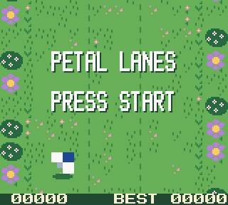
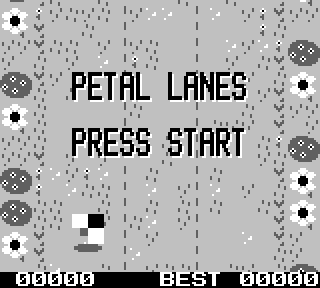

<div align="center">

 

# Hive Game Boy 🐝

**The Hive Solutions logo intro and Petal Lanes, a bee game, written in pure Game Boy assembly.**

[](https://boytacean.joao.me/?rom_url=https://raw.githubusercontent.com/joamag/gb-hive/master/hive.gb)
[](https://boytacean.joao.me/?rom_url=https://raw.githubusercontent.com/joamag/gb-hive/master/petal-lanes.gb)

[](#two-roms)
[](#two-roms)
[](https://rgbds.gbdev.io)
[](#under-the-hood)

</div>

<a name="two-roms"></a>

## Two ROMs 🕹️

| ROM | What it is | Download |
| --- | --- | --- |
| `hive.gb` | The Hive Solutions intro on its own. It keeps looping, START or A replays it. | [hive.gb](https://github.com/joamag/gb-hive/raw/master/hive.gb) |
| `petal-lanes.gb` | The same intro, then **Petal Lanes**. START or A skips the intro. The best score is saved on the cartridge. | [petal-lanes.gb](https://github.com/joamag/gb-hive/raw/master/petal-lanes.gb) |

Both run on the original Game Boy and on the Game Boy Color. They detect the console at boot and pick the right look: real colours on the Color, four crisp shades on the original. They also play on a Game Boy Advance through its Game Boy Color mode.

## The Hive intro 🎬

| Game Boy Color | Game Boy |
| :---: | :---: |
|  |  |
| [Watch with sound](media/hive-cgb.mp4) | [Watch with sound](media/hive-dmg.mp4) |

1. The screen fades in to the blue gradient of the Hive logo.
2. A bee, the Hive logo in miniature with flapping wings, flies in and loops around the screen leaving a pollen trail.
3. It lands in the middle and grows into the full logo, its squares spreading apart and snapping together with a two note chime.
4. A second bee leaves the hive and writes **HIVE SOLUTIONS** as it flies along the text line.
5. The bee keeps orbiting the logo, slipping behind it on the far side of every loop.

## Petal Lanes 🌸

| Game Boy Color | Game Boy |
| :---: | :---: |
|  |  |
| [Watch a full run with sound](media/petal-lanes-cgb.mp4) | [Watch a full run with sound](media/petal-lanes-dmg.mp4) |

The bee flies up a garden split into three lanes. Switch lanes to dodge spider webs and raindrops, and grab the pollen that sits in a free lane.

* **Left** and **Right** switch lanes, **START** or **A** starts a run.
* The garden speeds up the longer you last, from 1.2 to 3 pixels per frame.
* Distance is worth a point every ten pixels, each pollen is worth five, and every hundred points rings a chime.
* Raindrops fall faster than the ground scrolls, so watch the lanes ahead.
* Every row leaves at least one lane open, rows are spaced so two lane changes fit between them, and a raindrop never closes the only way through the row ahead.
* Your best score is saved in the cartridge's battery backed memory and shows up on the score bar.

## Play it ▶️

* **In the browser:** open the [intro](https://boytacean.joao.me/?rom_url=https://raw.githubusercontent.com/joamag/gb-hive/master/hive.gb) or [Petal Lanes](https://boytacean.joao.me/?rom_url=https://raw.githubusercontent.com/joamag/gb-hive/master/petal-lanes.gb) in Boytacean, they load straight from this repository in Game Boy Color mode.
* **Anywhere else:** grab a ROM from the table above and load it in any emulator or flash cart.

## Build 🔧

You need [RGBDS](https://rgbds.gbdev.io) 1.0 or later and Python 3 (standard library only, no packages).

```bash
make        # builds hive.gb and petal-lanes.gb
make clean  # removes the build output
```

`make` runs the two generators in `tools/` to produce the tiles, maps, palettes and tables, then assembles, links and fixes the headers of both ROMs.

<a name="under-the-hood"></a>

## Under the hood ⚙️

Both ROMs aim for a smooth 60 fps while leaving the CPU asleep for as much of each frame as possible.

| Metric | Intro | Petal Lanes |
| --- | --- | --- |
| CPU awake, average | 4.1% of each frame | 8.6% while playing |
| CPU awake, worst frame | 9.9% | 16.0% |
| VBlank updates finished by | line 148 | line 150 (VBlank ends at 153) |
| Interrupts | VBlank | VBlank and one line interrupt |
| ROM used | about 8 KB of 32 KB | about 14 KB of 32 KB |

*Measured with the Boytacean core: CPU time counts every cycle spent outside `halt`, and the VBlank figures come from stepping each frame and checking the scanline when the last video write is done, on both consoles.*

Every frame follows the same short loop:

```text
halt ─► VBlank ─► OAM DMA, scroll (+ palette or score digits) ─► build the next frame ─► halt
```

### Shared

* **Halt until VBlank.** The CPU sleeps until the frame is drawn, pushes the prepared frame to the hardware in one burst (an OAM DMA plus a few registers), then builds the next one.
* **Tables, not math.** Everything that can be precomputed is, by the generators in `tools/`. At runtime the code walks tables.
* **One runtime.** Console detection, the DMA routine and the memory helpers live in `src/runtime.asm`, used by both ROMs, and the intro is a single module that runs either on its own or as the opening of the game.

### The intro

* **A trail for free.** Each pollen dot reads an older entry of the bee's own path table, so the trail needs no state of its own.
* **Reveal by palette.** The logo and the text sit in the background map from the very first frame, hidden by the palette. Swapping the growing sprites for the real logo is one palette write.
* **Write with the window.** The text is uncovered by sliding the window layer, a single register per frame driven by the bee's position.
* **Depth without effort.** The bee slips behind the logo through the object priority bit, stored right in the path table.
* **Hardware limits checked at build time.** The growing logo is built from overlapping 8x16 objects, and the generator verifies every frame against the 40 objects and 10 per scanline limits.

### Petal Lanes

* **A garden that never changes.** The background is a 32x32 tile map that wraps, so scrolling is a single register and nothing is written to the map while playing.
* **A score bar that stays clean.** The score is the window layer pinned to the last 8 lines. One line interrupt, timed to land in the HBlank above the bar, switches objects off under it, so webs never draw over the digits.
* **One pass over the items.** Moving, colliding and drawing happen in a single loop, and only items level with the bee are tested for contact.
* **Fair by construction.** Rows are spaced by speed so two lane changes always fit between them, and a raindrop is never spawned into the only lane the row ahead leaves open, since it falls fast enough to catch up with it.
* **Saved on the cartridge.** The best score goes to MBC1 battery RAM with a small signature, so a blank or foreign save starts from zero.

## Project layout 📁

```text
.
├── Makefile            build rules (RGBDS)
├── hive.gb             prebuilt intro ROM
├── petal-lanes.gb      prebuilt game ROM
├── src
│   ├── hive.asm        entry point of hive.gb
│   ├── petal.asm       entry point of petal-lanes.gb
│   ├── runtime.asm     console detection, OAM DMA and memory helpers
│   ├── intro.asm       the Hive Solutions intro
│   ├── game.asm        Petal Lanes
│   └── hardware.inc    the hardware registers used by the ROMs
├── tools
│   ├── gen.py          intro tiles, maps, palettes and motion tables
│   └── gen_game.py     game tiles, garden map, palettes and tuning tables
└── media               animations and videos recorded with the Boytacean core
```

## Credits 🙏

* Logo and bee design by [Hive Solutions](https://hive.pt).
* Recorded and tested with [Boytacean](https://github.com/joamag/boytacean), a Game Boy emulator written in Rust.
* Built with [RGBDS](https://rgbds.gbdev.io).
